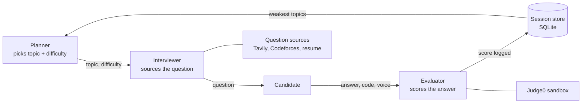

# AI Interview Coach

A multi-agent mock-interview system that adapts to what you're weak at, asks questions tailored to your target company, role and resume, and grades your code by actually running it.


## Features

- **Adaptive practice.** A Planner agent tracks your scores per topic and keeps returning to your weakest area, raising or lowering difficulty based on how you're doing.
- **Real, company-aware questions.** DSA questions come from live web search for your target company, with Codeforces as a fallback. Behavioral questions are grounded in your own resume or searched for your company and role. Nothing comes from a fixed question list unless every live source fails.
- **Two round types.** *Technical* is one DSA question plus one resume-based question. *Behavioral* is a run of HR-style questions, each different from the last.
- **Code graded by execution.** Paste just your `Solution` class. A test harness is generated from the question's worked example, run in a sandbox, and the output is compared against the expected result.
- **Voice answers.** Answer by speaking, using your browser's microphone. A separate communication score measures filler words and pace without affecting your correctness score.
- **Resume upload.** Upload a PDF or paste text.
- **Streamlit web UI and a terminal version.**

## How it works



The agents are nodes in a [LangGraph](https://github.com/langchain-ai/langgraph) `StateGraph` that share one state object.

### Question sourcing

Each question type tries sources in order and falls back so a session never dies on a failed API call.

| Question type | 1st choice | 2nd choice | Last resort |
|---|---|---|---|
| DSA (arrays, graphs, DP) | Live search for your company and role (Tavily) | Codeforces API | Small built-in bank |
| Resume-based | LLM question grounded in your resume | Company and role search | Small built-in bank |
| HR / behavioral | Company and role search | | Small built-in bank |

Fetched questions are cached in SQLite, keyed by topic, difficulty, company and role. Repeated rounds on the same weak topic skip the cache and pass a list of already-asked questions, so you don't get the same question twice.

### Grading, and why the LLM doesn't get the last word

An LLM scores the content of each answer from 0 to 10. Anything that can be checked by code is checked by code instead:

- **Sandbox failures cap the score.** In testing, the LLM gave 9/10 to code that had crashed with a segfault, because the explanation sounded right. If the code fails to compile or crashes, the score is now capped regardless of what the LLM said.
- **Test results cap the score proportionally.** If 2 of 4 test cases pass, the score cannot exceed 5/10.
- **Pass/fail is computed in Python.** The LLM writes the test driver around your code, but comparing actual output to expected output is a plain string comparison.
- **Communication is scored separately.** Filler-word rate and speaking pace are computed deterministically from the raw transcript. Your correctness score only ever sees a cleaned transcript.

## Tech stack

| Area | Tools |
|---|---|
| Orchestration | Python, LangGraph |
| LLM and speech | Groq (`openai/gpt-oss-120b` for reasoning, `whisper-large-v3` for speech-to-text) |
| Live data | Tavily (web search), Codeforces API |
| Code execution | Judge0 CE public instance (Python, C++, Java, JavaScript) |
| Storage | SQLite, JSON files |
| UI | Streamlit |
| Resume parsing | pypdf |

## Project structure

```
.
├── app.py              # Streamlit UI
├── ui_logic.py         # UI-side round orchestration (no Streamlit imports)
├── main.py             # Terminal entry point
├── graph.py            # LangGraph wiring
├── state.py            # Shared state schema
├── planner.py          # Topic and difficulty selection
├── interviewer.py      # Question sourcing
├── evaluator.py        # Scoring and deterministic safeguards
├── check_setup.py      # Verifies every cross-file import resolves
├── tools/              # Codeforces, web search, sandbox, test harness,
│                       # speech-to-text, resume reader, communication scorer
├── memory/             # Session history, question cache, candidate profile
└── tests/              # 46 tests, no network or API keys needed
```

## Getting started

**Requirements:** Python 3.10 or newer, a [Groq API key](https://console.groq.com), and a [Tavily API key](https://tavily.com). Both have free tiers.

```bash
git clone <your-repo-url>
cd <your-repo-name>

python3 -m venv venv
source venv/bin/activate        # Windows: venv\Scripts\activate
pip install -r requirements.txt

cp .env.example .env            # then add your two keys to .env
python3 check_setup.py          # confirms everything is wired up
```

`.env` should contain:

```
GROQ_API_KEY=your_key_here
TAVILY_API_KEY=your_key_here
```

### Run

```bash
streamlit run app.py            # web UI
python3 main.py                 # terminal version
```

In the web UI, voice answers use your browser's microphone, so allow access when prompted. The terminal version records through `sounddevice`, which needs PortAudio (`brew install portaudio` on macOS) and falls back to typed input if recording fails.

### Test

```bash
pip install pytest
python3 -m pytest
```

## Usage notes

- Your profile (company, role, resume) is saved locally in `data/`, so you don't re-enter it each run.
- Scores, cached questions and asked-question history also live in `data/`. Delete that folder for a clean slate.
- For C++, standard headers are added automatically. Paste only your `Solution` class when the question includes a worked example. Questions without one (for example Codeforces links) need a complete program with a `main()`.

## Known limitations

- **Test cases come from the question's own worked example**, usually one case, not a hidden suite. A solution can pass and still be wrong on edge cases. "Accepted" in the single-run fallback means the code ran without crashing, not that it is correct.
- **Codeforces gives metadata only** (title, rating, tags, link), so those questions can't get an auto-generated harness.
- **Live search can come back empty or noisy.** That's why every source has a fallback.
- **Content scoring still depends on an LLM judge**, so it can vary between runs. The deterministic caps limit how far it can drift on code.
- **Free-tier services are rate limited**: Groq, Tavily and the public Judge0 instance.

## Roadmap

- Multiple generated edge-case tests per question, validated against a reference solution
- Embedding-based duplicate detection instead of exact-text avoidance lists
- Measuring the content scorer against human ratings
- Multi-user support with a hosted database
